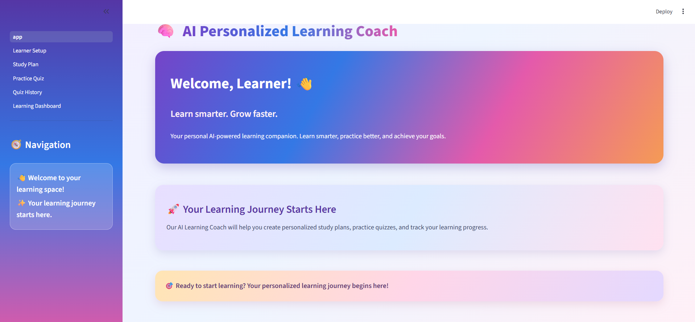
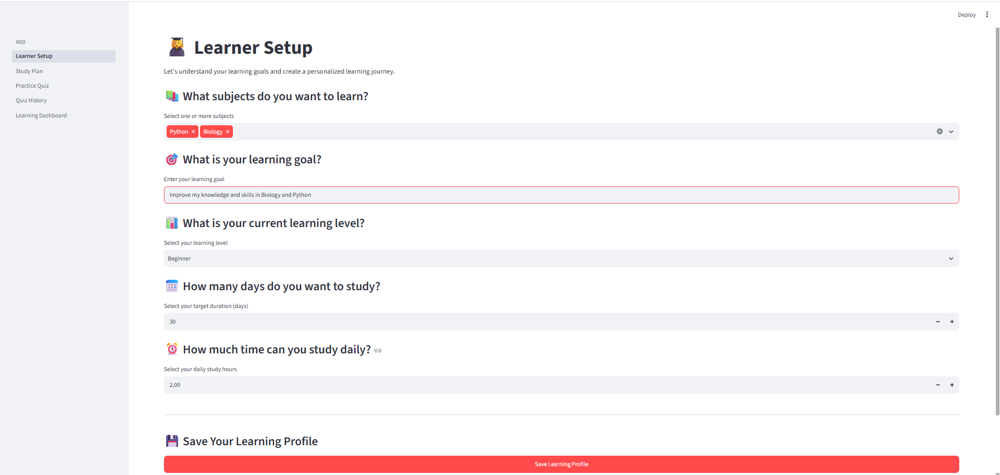
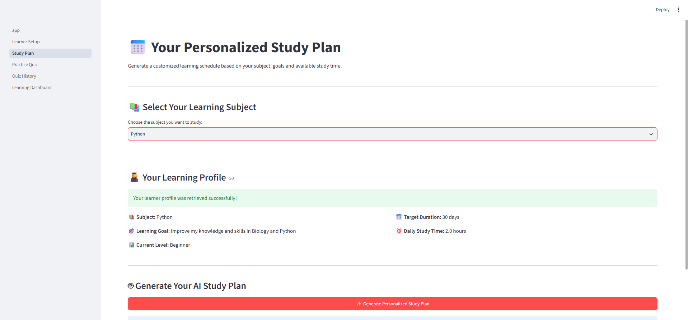
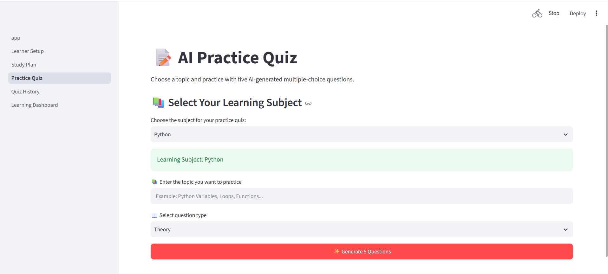
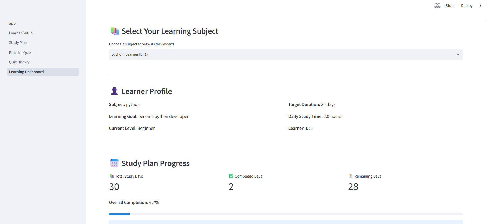

# AI Personalized Learning Coach

An AI-powered learning application built with **Python, Streamlit,
Google Gemini, and SQLite**. It helps learners create subject-specific
study plans, practise with AI-generated quizzes, review their results,
and track learning progress.

**GitHub repository:**
https://github.com/chethansree77/ai-personalized-learning-coach

## Project Overview

The AI Personalized Learning Coach brings study planning and practice
into one application. Learners can create profiles for different
subjects, generate a day-wise study roadmap, complete practice quizzes,
and review their progress through subject-specific history and dashboard
views.

The application uses Google Gemini for AI-generated learning content. A
demo fallback is available when the AI service cannot generate a
response, such as when a free-tier quota is reached or the service is
temporarily unavailable.

## Problem Statement

Learners often need to organize their study schedule, find relevant
practice questions, understand mistakes, and monitor their progress.
Managing these activities separately can make consistent learning
difficult.

This project provides a single application for organizing study goals,
generating study plans, practising questions, and reviewing performance.

## Objectives

-   Create and manage learning profiles for multiple subjects.
-   Generate a personalized, day-wise study plan based on a learner's
    profile.
-   Track completed study-plan days.
-   Generate practice quizzes for a selected subject and topic.
-   Support Theory and Maths/Aptitude question formats.
-   Evaluate submitted quiz answers in Python.
-   Show explanations and review answers after quiz submission.
-   Save quiz attempts and display subject-wise learning history.
-   Present progress and topic-performance insights on a dashboard.

## Key Features

### 1. Learner Setup

-   Add learning profiles for subjects such as Python, Biology,
    Mathematics, and other supported subjects.
-   Set a learning goal, current level, target duration, and daily study
    hours.
-   Save learner information in an SQLite database.
-   Update the latest profile for a subject rather than creating another
    profile every time the same subject is saved.

### 2. Personalized Study Plan

-   Select a learner profile by subject.
-   Generate a day-wise study roadmap using Gemini.
-   Save the generated plan in SQLite.
-   Mark study days as completed and track completion progress.

### 3. Practice Quiz

-   Select a subject and enter a topic to practise.
-   Choose between Theory and Maths/Aptitude question formats.
-   Generate a five-question multiple-choice quiz.
-   Evaluate answers in Python and calculate the score.
-   Review correct answers and explanations after submission.
-   Use the demo fallback when AI generation is unavailable.

### 4. Quiz History

-   View saved quiz attempts by subject.
-   Review scores, accuracy, topics, and attempt details.
-   Compare previous attempts for the selected learner.

### 5. Learning Dashboard

-   View the selected learner's profile and study-plan progress.
-   Review quiz attempt count, average accuracy, and best accuracy.
-   See topic performance, including stronger areas and areas that need
    more practice.
-   View recommendations based on recorded performance.

### 6. User Interface

-   Streamlit multi-page application.
-   Custom CSS styling for a colorful interface.
-   Navigation through the application sidebar.

## Technology Stack

  -----------------------------------------------------------------------
  Technology                          Purpose
  ----------------------------------- -----------------------------------
  Python                              Application logic and quiz
                                      evaluation

  Streamlit                           Web application interface

  Google Gemini API                   AI-generated study plans and quiz
                                      content

  SQLite                              Store learner profiles, study
                                      plans, progress, and quiz attempts

  Pandas                              Data handling and dashboard support

  python-dotenv                       Load the Gemini API key from
                                      environment variables
  -----------------------------------------------------------------------

## Project Structure

``` text
ai-personalized-learning-coach/
│
├── app.py
│
├── pages/
│   ├── 02_Learner_Setup.py
│   ├── 03_Study_Plan.py
│   ├── 04_Practice_Quiz.py
│   ├── 05_Quiz_History.py
│   └── 06_Learning_Dashboard.py
│
├── services/
│   ├── demo_quiz_service.py
│   ├── gemini_service.py
│   ├── quiz_service.py
│   ├── report_generator.py
│   └── study_plan_service.py
│
├── database/
│   └── db.py
│
├── assets/
│   └── style.css
│
├── screenshots/
│   ├── home.png
│   ├── learner_setup.png
│   ├── study_plan.png
│   ├── practice_quiz.png
│   ├── quiz_history.png
│   └── dashboard.png
│
├── utils/
│
├── .env.example
├── .gitignore
├── README.md
└── requirements.txt
```

The SQLite database file is created locally by the application and is
not intended to be committed to GitHub.

## Installation and Setup

### 1. Clone the repository

``` bash
git clone https://github.com/chethansree77/ai-personalized-learning-coach.git
cd ai-personalized-learning-coach
```

### 2. Create and activate a virtual environment

**Windows PowerShell:**

``` powershell
python -m venv venv
.\venv\Scripts\Activate.ps1
```

If PowerShell blocks activation, use the appropriate execution-policy
setting for your environment or activate the environment from your VS
Code terminal.

### 3. Install dependencies

``` bash
python -m pip install --upgrade pip
pip install -r requirements.txt
```

### 4. Configure the Gemini API key

Create a file named `.env` in the project root, next to `app.py`, and
add:

``` env
GEMINI_API_KEY=your_gemini_api_key_here
```

Replace the placeholder with your own Gemini API key.

**Important:** Keep `.env` private. Do not commit it or share your API
key. The repository includes `.env.example` as a safe template.

### 5. Run the application

``` bash
streamlit run app.py
```

Streamlit will display a local URL in the terminal. Open that URL in
your browser.

## Application Workflow

1.  Open the application.
2.  Go to **Learner Setup** and create a profile for a subject.
3.  Open **Study Plan**, select the subject, and generate a study
    roadmap.
4.  Mark completed study days as you progress.
5.  Open **Practice Quiz**, select the subject and topic, and complete a
    quiz.
6.  Submit all answers to see your score and explanations.
7.  Visit **Quiz History** to review previous attempts.
8.  Open **Learning Dashboard** to review study progress and quiz
    performance.

## AI Generation and Demo Fallback

The application uses the Gemini API for supported AI-generated content.
AI service availability can vary due to quota limits, model
availability, or temporary service errors.

When AI generation is unavailable, the application can use its demo
fallback so that the relevant workflow can still be demonstrated.
Demo-generated content should be understood as sample content, not as a
response generated by Gemini.

## Data and Security Notes

-   Learner profiles, study plans, study progress, and quiz attempts are
    stored in a local SQLite database.
-   The database file is excluded from Git using `.gitignore`.
-   The `.env` file is excluded from Git to help protect API
    credentials.
-   Never publish API keys, passwords, or other private credentials.

## Current Project Status

The core application features have been implemented and tested,
including learner setup, subject-specific study plans, study progress
tracking, practice quizzes, quiz history, and the learning dashboard.

Further testing, documentation refinement, and deployment preparation
can continue as the project develops.

## Future Enhancements

-   Add more learning and assessment formats.
-   Improve recommendations using a larger history of learner
    performance.
-   Add more detailed progress visualizations.
-   Explore deployment so the application can be accessed online.

## Latest Update

### 📄 Downloadable PDF Learning Progress Report

- Generate personalized PDF progress reports.
- View learner profile and learning goals.
- Track completed and remaining study days.
- Review quiz scores and average accuracy.
- Access quiz attempt history.
- Download reports directly from the Learning Dashboard.

## Author

**Chintha Chethana Sai Sree**

GitHub: https://github.com/chethansree77

## Application Screenshots

### 1. Home Page


### 2. Learner Setup


### 3. Study Plan


### 4. Practice Quiz


### 5. Learning Dashboard

