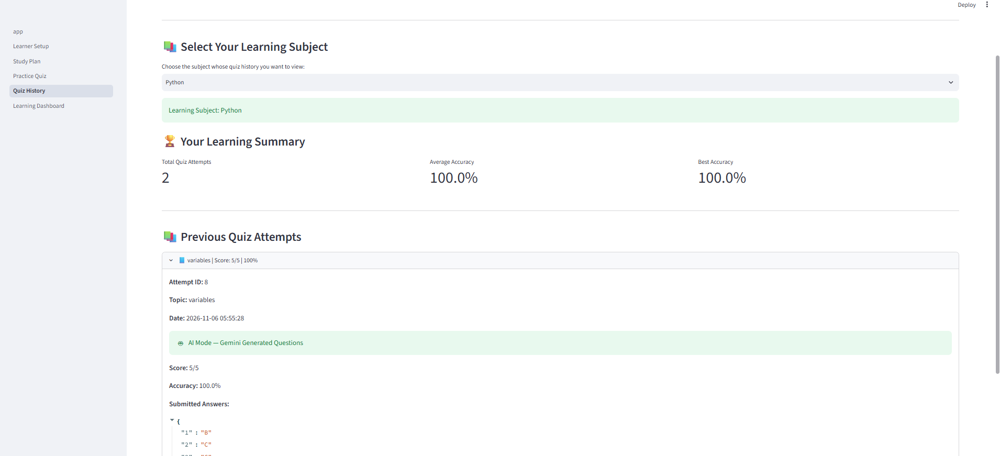

# 🎓 AI Personalized Learning Coach

An AI-powered personalized learning application built with **Python, Streamlit, Google Gemini API, and SQLite**. It helps learners create personalized study plans, practise with AI-generated quizzes, understand their mistakes, and monitor their learning progress.

**GitHub Repository:** https://github.com/chethansree77/ai-personalized-learning-coach

---

## 📌 Project Overview

AI Personalized Learning Coach brings study planning, practice, and progress tracking into one application.

Learners can:
- Create learning profiles for different subjects.
- Generate personalized, day-wise study plans.
- Complete topic-based practice quizzes.
- Review answers and detailed explanations.
- Track study progress and quiz performance.
- Download a PDF learning progress report.

The application uses Google Gemini for AI-generated learning content and provides a demo fallback when the AI service is unavailable.

## 🎯 Problem Statement

Learners often struggle to organize study schedules, find relevant practice questions, understand mistakes, and monitor their progress.

This project provides a single platform to manage learning goals, generate study plans, practise questions, and review performance.

## 🎯 Project Objectives

- Create and manage multiple subject-based learner profiles.
- Generate personalized study plans.
- Track completed study days.
- Generate and evaluate practice quizzes.
- Provide explanations and feedback.
- Store quiz attempts and learning progress.
- Display performance insights through a dashboard.
- Generate downloadable PDF progress reports.

## ✨ Key Features

### 1. Learner Setup
- Create profiles for subjects such as Python, Biology, and Mathematics.
- Set learning goals, current level, target duration, and daily study hours.
- Save learner information in SQLite.
- Update the latest profile for an existing subject.

### 2. Personalized Study Plan
- Generate day-wise study roadmaps using Gemini.
- Personalize plans using learner profile information.
- Store generated plans in SQLite.
- Mark completed days and monitor progress.

### 3. AI Practice Quiz
- Select a subject and enter a practice topic.
- Choose Theory or Maths/Aptitude questions.
- Generate five multiple-choice questions.
- Evaluate answers using Python.
- Display scores, correct answers, and explanations.
- Use demo questions when AI generation is unavailable.

### 4. Quiz History
- View previous quiz attempts.
- Review scores, accuracy, topics, and attempt details.
- Compare performance across attempts.

### 5. Learning Dashboard
- View learner profile and study progress.
- Track total quiz attempts, average accuracy, and best accuracy.
- Identify stronger and weaker topics.
- View personalized learning recommendations.

### 6. PDF Learning Progress Report
- Generate downloadable PDF reports.
- View learner details and learning goals.
- Track completed and remaining study days.
- Review quiz scores and average accuracy.
- Access quiz attempt history.

### 7. User Interface
- Multi-page Streamlit application.
- Custom CSS styling.
- Gradient backgrounds, interactive cards, shadows, and hover effects.
- Sidebar navigation.

## 🛠️ Technology Stack

| Technology | Purpose |
|---|---|
| Python | Application logic and quiz evaluation |
| Streamlit | Web application interface |
| Google Gemini API | AI-generated study plans and quiz content |
| SQLite | Store learner profiles, plans, progress, and quiz attempts |
| Pandas | Data handling and dashboard support |
| python-dotenv | Load API credentials from environment variables |
| ReportLab | Generate PDF learning progress reports |

## 📂 Project Structure

```text
ai-personalized-learning-coach/
│
├── app.py
│
├── pages/
│   ├── 02_Learner_Setup.py
│   ├── 03_Study_Plan.py
│   ├── 04_Practice_Quiz.py
│   ├── 05_Quiz_History.py
│   └── 06_Learning_Dashboard.py
│
├── services/
│   ├── demo_quiz_service.py
│   ├── gemini_service.py
│   ├── quiz_service.py
│   ├── report_generator.py
│   └── study_plan_service.py
│
├── database/
│   └── db.py
│
├── assets/
│   └── style.css
│
├── screenshots/
│   ├── home.png
│   ├── learner_setup.png
│   ├── study_plan.png
│   ├── practice_quiz.png
│   ├── quiz_history.png
│   └── dashboard.png
│
├── utils/
├── .env.example
├── .gitignore
├── README.md
└── requirements.txt
```

The SQLite database is created locally by the application and is excluded from Git.

## ⚙️ Installation and Setup

### 1. Clone the repository

```bash
git clone https://github.com/chethansree77/ai-personalized-learning-coach.git
cd ai-personalized-learning-coach
```

### 2. Create a virtual environment

Windows PowerShell:

```powershell
python -m venv venv
.\venv\Scripts\Activate.ps1
```

### 3. Install dependencies

```bash
python -m pip install --upgrade pip
pip install -r requirements.txt
```

### 4. Configure the Gemini API key

Create a `.env` file in the project root, next to `app.py`.

Add:

```env
GEMINI_API_KEY=your_gemini_api_key_here
```

Replace the placeholder with your own API key.

**Security:** Never upload your `.env` file or share your API key. The repository includes `.env.example` as a safe configuration template.

### 5. Run the application

```bash
streamlit run app.py
```

Open the local URL displayed in your terminal.

## 🔄 Application Workflow

1. Open the application.
2. Create a learner profile in Learner Setup.
3. Generate a personalized roadmap in Study Plan.
4. Mark completed study days.
5. Generate and complete quizzes in Practice Quiz.
6. Review results and explanations.
7. Check previous attempts in Quiz History.
8. Monitor progress in Learning Dashboard.
9. Download the PDF Learning Progress Report.

## 🤖 AI Generation and Demo Fallback

The application uses Google Gemini for AI-generated learning content.

AI service availability may vary because of:
- API quota limits.
- Model availability.
- Temporary service errors.

When AI generation is unavailable, the application can use predefined demo questions for the practice quiz workflow. Demo content is sample content and should not be confused with Gemini-generated responses.

## 🔐 Data and Security

- Learner profiles and study plans are stored in SQLite.
- Study progress and quiz attempts are saved locally.
- The SQLite database is excluded from Git.
- API credentials are stored in `.env`.
- Private credentials must never be committed to GitHub.

## ✅ Project Status

The core application features have been implemented and functionally tested:

- Learner profile creation and updates.
- Personalized study-plan generation and progress tracking.
- Practice quiz generation, submission, scoring, and explanations.
- Quiz history and saved results.
- Learning dashboard and performance insights.
- Downloadable PDF learning progress reports.

## 🚀 Future Enhancements

- Add more learning and assessment formats.
- Improve recommendations using additional learner history.
- Add more detailed progress visualizations.
- Deploy the application online.
- Expand subject and question coverage.

## 📸 Application Screenshots

Add the corresponding screenshot files to the `screenshots/` folder.

### 1. Home Page


### 2. Learner Setup


### 3. Study Plan


### 4. Practice Quiz


### 5. Quiz History


### 6. Learning Dashboard


---

## 👩‍💻 Author

**Chintha Chethana Sai Sree**

GitHub: https://github.com/chethansree77

**Project:** AI Personalized Learning Coach